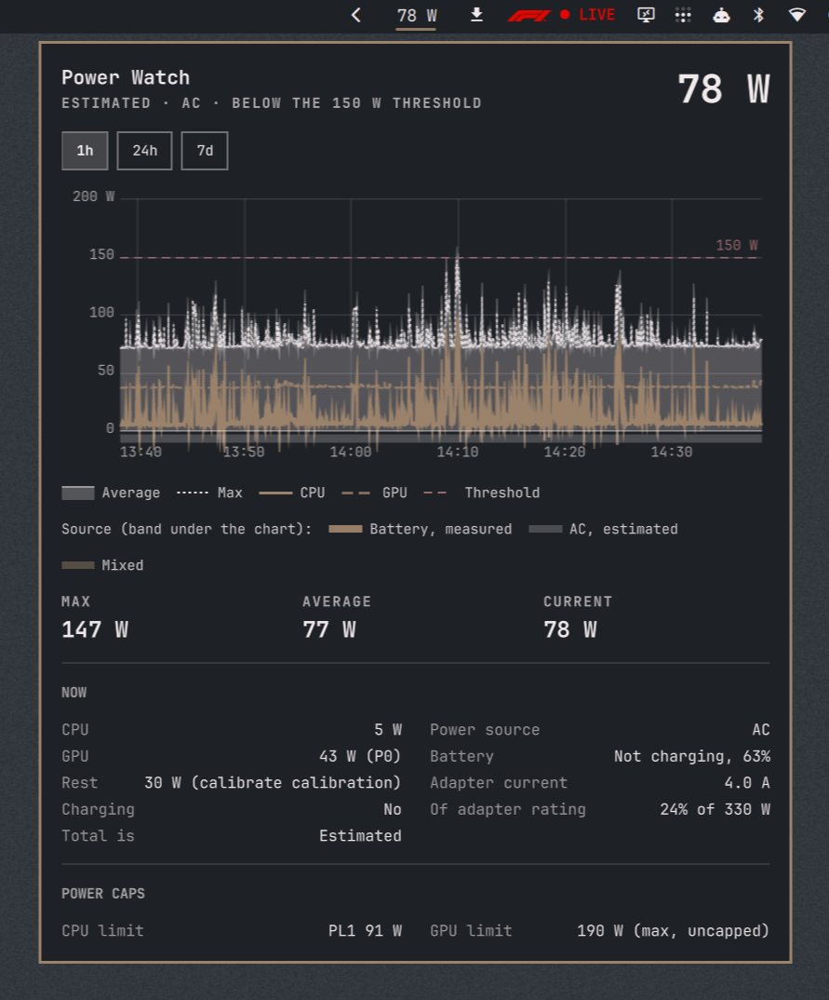

# Power Watch

An [Omarchy](https://omarchy.org) shell bar widget that shows the load on your AC
adapter, in watts, as reported by the [power-watch](https://github.com/rsd/power-watch)
service. Plugin id `io.github.rsd.power-watch`.



- **Bar.** The load in watts, colored as normal, approaching (from 85 % of the
  threshold) or over. A total that is only a lower bound (some terms unknown,
  counted as 0 W) is marked with "≥". Measured platform power and a suspended
  GPU are labelled, and the tooltip says how the number was obtained.
- **Panel** (click the widget). Charts for 1h, 24h and 7d: average, max, CPU and
  GPU, the threshold, and a band for the power source (battery, AC measured or
  estimated, mixed). Below: Max, Average and Current, the breakdown of the
  current sample and the CPU/GPU power caps. Left/right change the range. Adapter
  amps and the share of the adapter rating show "Not configured" when the
  service has no voltage or rating.
- **Colours.** The average, Max and the AC bands use the theme's foreground,
  the threshold its urgent colour, and all text stays foreground. CPU, GPU and
  the battery band each get their own colour (Mixed is the Battery colour at
  alpha 0.45), derived from the theme: CPU keeps the accent's hue, GPU and
  Battery are hues rotated from it in OKLCH. All three stay far apart for
  normal and colour-blind vision, have at least 3:1 contrast against the panel
  background (dark or light is judged from the panel background itself, so a
  foreground equal to the background cannot undo it), keep clear of the urgent
  hue, and stay out of the red hues (OKLCH 345–45°) whatever urgent is; an
  accent in either is moved just clear of it. A grey theme (accent equal to the
  foreground) still gets three hues. The series also differ in pattern: CPU is
  a thick solid line, GPU thick long dashes, Max thin dots. The colours are
  worked out only while the panel is open.
- **CPU cap.** When the service reports its CPU power-cap state, the CPU limit
  reads "PL1 45 W (capped)" (in the accent colour), "PL1 91 W (uncapped)", or
  "PL1 91 W (45 W cap reverted)" (in the urgent colour, with the note "CPU cap
  reverted by something else; see power-cap status."): something other than
  power-watch undid the cap. Without a usable cap figure (missing or 0 W) it
  reads "PL1 91 W (cap reverted)". An older power-watch that does not report
  it shows plain "PL1 91 W".
- **Staleness.** When the service stops, the number turns into `-- W`, the widget
  dims and the panel says so and shows how to start the service.

## Requirements

The widget only displays what the **power-watch** service writes, so the service
has to be installed and running: <https://github.com/rsd/power-watch>.

From a power-watch checkout:

```bash
sudo ./install.sh            # the power-watch and power-cap commands, the systemd user unit, the RAPL read rule
./install.sh --user          # as your normal user: enables and starts the user service
```

The service records history only when it runs as the user service (`power-watch
--quiet`, which the unit does). Details, options and the security trade-off of
the RAPL rule are in the power-watch README.

## Install

```bash
omarchy plugin add https://github.com/rsd/omarchy-power-watch --enable
```

This clones the repository into `~/.config/omarchy/plugins/io.github.rsd.power-watch`,
validates it, and with `--enable` puts the widget in the bar (it asks which
section; the default is `right`). Without `--enable`, enable it later with
`omarchy plugin enable io.github.rsd.power-watch right`.

`omarchy plugin add` refuses an id that is already installed. If an earlier
power-watch checkout linked a bundled copy of this plugin there, remove that
link first.

Move the widget with `omarchy bar move io.github.rsd.power-watch --section right`
(see `omarchy bar --help`).

### Removal

```bash
omarchy plugin remove io.github.rsd.power-watch      # asks to confirm; --yes skips
```

This disables the plugin and deletes its folder. Nothing needs to be stopped
first and nothing is left behind: the plugin writes no files. The service is
separate and keeps running.

## Data contract it reads

The widget reads files the service writes; it does not talk to the service.
[power-watch's README, "Data contract (public
interface)"](https://github.com/rsd/power-watch#data-contract-public-interface)
is **authoritative**. This section is what this plugin relies on today, taken
from `Model.js`.

**State directory**, as the shell process sees it: `$POWER_WATCH_STATE_DIR` if
set and non-empty, else `$XDG_STATE_HOME/power-watch`, else
`~/.local/state/power-watch`. If you set the variable for the service, set it
for the shell too (or for neither). The variable must be an **absolute path**:
a relative one resolves differently for the size check (which lists the
directory) and for the read, so the check would gate a different file than the
one read.

**`current.json`**: one JSON object, rewritten atomically after each sample.
Read when its size or mtime changes, at most once a second per bar, and never
when larger than 16 KiB. Fields shown (anything of the wrong type, non-finite or
out of range is treated as not reported, i.e. `null`, never as a number; text
is stripped of control and markup characters and capped):

| Field | Used for |
|---|---|
| `epoch` (Unix seconds), `interval_s` (0.05–3600 s, default 2) | staleness: the sample is stale after 3 × max(`interval_s`, 1 s) |
| `total_w`, `total_kind` (`measured`/`estimated`), `total_source` (`battery`/`psys`/`model`), `total_lower_bound`, `incomplete` | the bar number, its label and the "≥" mark |
| `threshold_w` (default 150) | normal / approaching (85 %) / over |
| `ac_online`, `battery_status`, `battery_capacity` (0–100), `charge_w` | power source and charging row |
| `cpu_w`, `gpu_w`, `rest_w`, `rest_source` (`calibrate` shows as "calibrated", `passive` as "passively calibrated", `default` as a warning) | breakdown |
| `gpu_status` (`active`/`suspended`/`none`/`disabled`/`unknown`), `gpu_pstate`, `gpu_devices` (each entry's `status`, and how many there are; at most 16 kept) | GPU row |
| `adapter_v`, `adapter_current_a`, `adapter_rating_w` | amps and share of rating; `null` = "Not configured" |
| `cpu_limit_w`, `gpu_limit_w`, `gpu_max_limit_w` | power caps |
| `cpu_cap` (`capped`/`uncapped`/`reverted`), `cpu_cap_w` (the PL1 cap applied, W), both optional | CPU cap state after PL1; absent, `null` or any other value = not reported, plain "PL1 N W" |
| `errors` (only its length) | "sensor error(s)" note |

Parsed and validated but not shown: `battery_w`, `psys_w`, and the `pci`,
`vendor` and `power_w` of each `gpu_devices` entry. Fields not listed here are
ignored.

All power values are watts, the adapter voltage volts, current amps. `null`
means unknown, and is shown in words ("Not configured", "Suspended") or as a
dash, never as 0.

**`history-raw.jsonl`** (1h), **`history-1m.jsonl`** (24h), **`history-15m.jsonl`**
(7d): JSON Lines, read only while the panel is open, never when larger than
16 MiB, and at most every 5 s for 1h and once a minute for 24h and 7d (those
tiers change once a minute or less). Opening the panel or switching the range
reads at once. A line is an object with `t` (bucket start, Unix
seconds), `n` (samples), `avg` and `max` (total, W), `cpu`, `gpu`, `rest`, `chg`
(W), `ac` (fraction of samples on AC, 0–1) and `k` (`m` measured, `e`
estimated, `x` mixed). Points more than 2.5 steps apart are drawn as a gap, never
interpolated. At most the newest 4 MiB / 40 000 lines are parsed.

## Without the service

Everything degrades to a stated reason; nothing throws or shows `NaN`.

| Situation | Bar | Panel |
|---|---|---|
| `current.json` missing or empty | `-- W`, dimmed | "The power-watch service is not running (no current.json)." and the start command |
| Sample older than 3 intervals | `-- W`, dimmed | "... (last sample is old)." breakdown dimmed and titled as the last sample |
| `current.json` over 16 KiB | keeps the last good sample until it goes stale | once stale: "current.json is too large to read ... not read." |
| `current.json` not valid JSON / not an object | same | once stale: "current.json is unreadable." |
| History file missing | no effect | "No history for this range yet" |
| History file over 16 MiB / unreadable | no effect | "History file too large to read ... not read." / "History file unreadable." |
| Torn or garbage history lines | no effect | skipped and counted ("N unreadable history lines skipped.") |

## What it never does

It makes no network access, writes no files, and starts no processes: the
sources contain no `Process`, no `execDetached`, no `XMLHttpRequest`, and the
only files opened are the four above, read through a size gate (a directory
listing says how big a file is before it is read). The start command shown when
the service is not running (`systemctl --user enable --now power-watch.service`)
is display text; nothing executes it. It does not read the power-watch
configuration. The only repeating timer is a 10 s staleness check that
compares two numbers (and re-lists the state directory while `current.json` is
missing); besides it there are two single-shot timers per file, one that
rate-limits reads (`current.json` to once a second, history per range) and one
that settles a state directory that does not exist.

### Notes for reviewers

- The `git clone`, `sudo ./install.sh` and `systemctl` strings in this README,
  and the start command shown in the panel when the sample is stale, are display
  text only. Nothing in the plugin runs them.
- The plugin spawns no processes and has no network access (no `Process`,
  `execDetached` or `XMLHttpRequest`).
- Files are read with `FileView` behind a size gate taken from a directory
  listing. That cap is advisory, as documented in `GatedFile.qml`: symlinks are
  followed, there is no limit while reading, and a file that grows between the
  listing and the read is not caught. The writer is the user's own service in
  the user's own state directory.

### Known limitation

At the service's fastest interval (0.05 s) the 1h raw history file fills the
parse budget (4 MiB / 40 000 lines), and parsing it takes about 310 ms on the UI
thread every 5 s while the panel is open on the 1h range (measured). At the
default 2 s interval it is about 15 ms. The 24h and 7d tiers reload at most once
a minute. The budget is not lowered in this version.

## Dev workflow

Work in a checkout outside the shell's plugin directory and symlink it in. The
folder name must equal the manifest id, and no symlink may exist inside the
plugin folder.

```bash
git clone https://github.com/rsd/omarchy-power-watch ~/Devel/Omarchy/plugins/io.github.rsd.power-watch
ln -s ~/Devel/Omarchy/plugins/io.github.rsd.power-watch ~/.config/omarchy/plugins/io.github.rsd.power-watch

omarchy plugin validate ~/Devel/Omarchy/plugins/io.github.rsd.power-watch   # the real path, not the link
omarchy-shell shell rescanPlugins      # a symlinked folder is not watched; rescan after adding or renaming files
omarchy restart shell                  # the shell caches QML: an edit only loads after a restart
omarchy plugin enable io.github.rsd.power-watch right
```

`Model.js` holds every parse and calculation; the QML only lays them out.

## Tests

```bash
tests/run.sh
```

Needs `node` and the `omarchy` CLI. Suites:

- `omarchy plugin validate`
- `qmllint` from Qt 6 (`/usr/lib/qt6/bin/qmllint`; `/usr/bin/qmllint` is Qt 5's
  and rejects valid Qt 6 QML) against the shell's own `qs.Ui` and `qs.Commons`
  (`/usr/share/omarchy/shell`, override with `OMARCHY_SHELL_DIR`), judged from
  its `--json` output by `tests/qmllint-check.js` (the text output of Qt 6.12
  drops `[import]` and `[unresolved-type]` for files with a loop). Fails on a
  non-zero exit, on any `syntax`, `import` or `unresolved-type` warning, and on
  any warning in a file other than `BarWidget.qml` except
  `block-scope-var-declaration`. Reported as **skipped**, not passed, when the
  linter, the shell sources or node are missing.
- A lint self-test: injects an unknown type into copies of `BarWidget.qml` and
  `Chart.qml` and requires the lint check to fail for each.
- `tests/model-test.js`: the model under node. One test compares the state
  directory with the service's own `state_dir()`; it finds the service through
  `POWER_WATCH_BIN` or `power-watch` on `PATH` and otherwise prints a `skip`
  line, which is left out of the "N/N passed" count. A `POWER_WATCH_BIN` that
  is not an existing file fails the test.
- `tests/manifest-test.js`: manifest, folder name equals the manifest id, entry
  points, relative imports, no symlinks.

## License

MIT, see [LICENSE](LICENSE).
